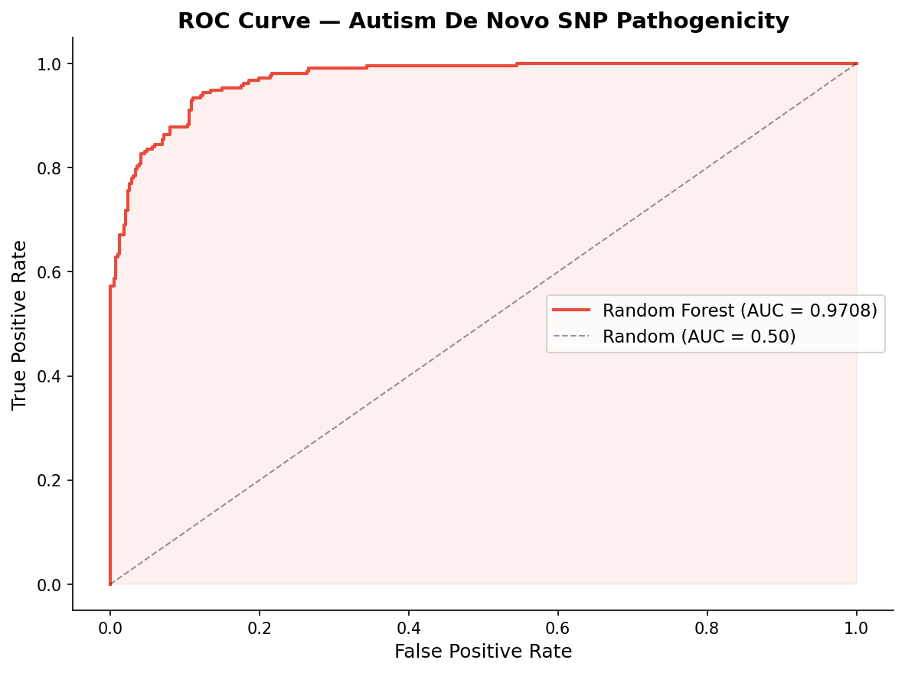
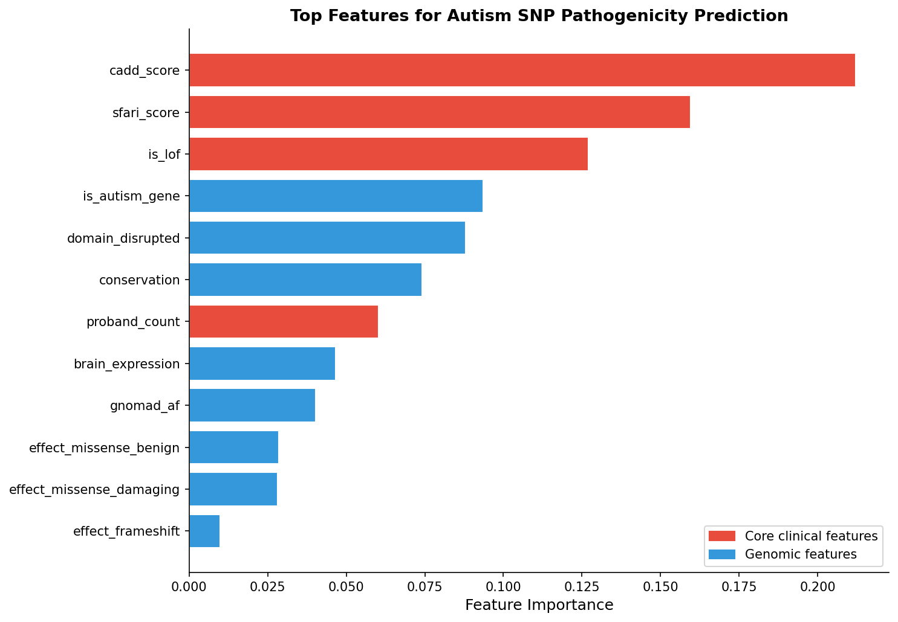
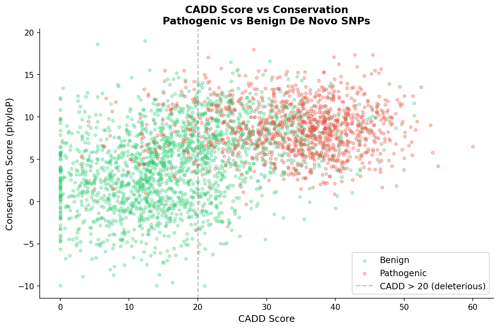
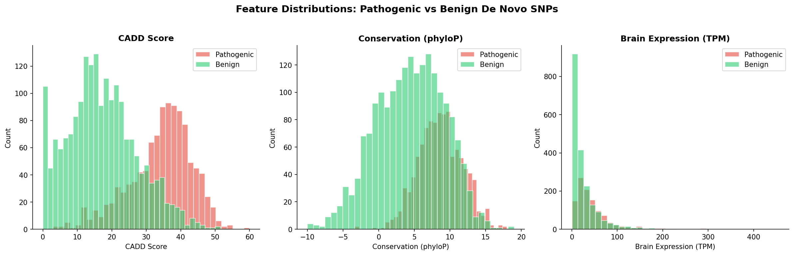
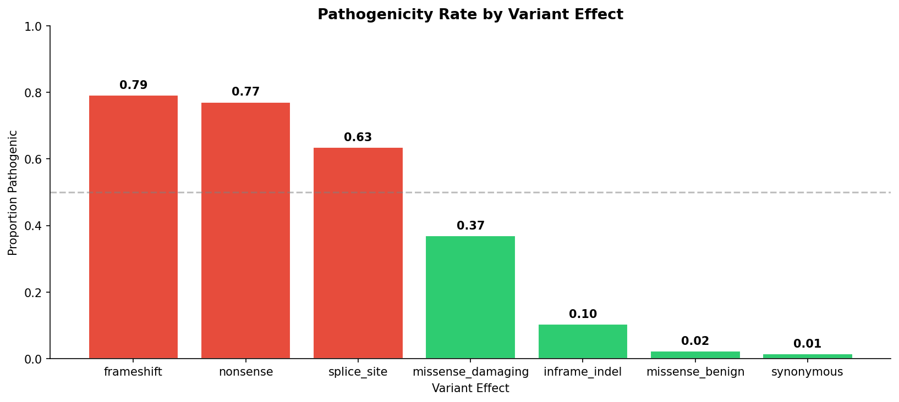
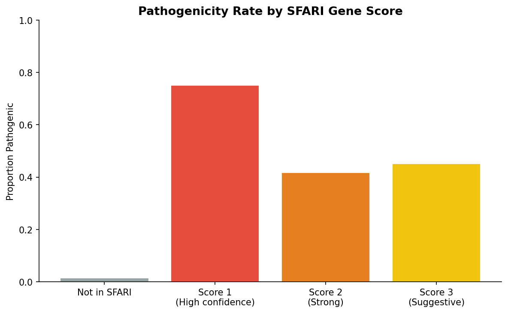

# 🧬 Autism De Novo SNP Pathogenicity Classifier

**Author:** Rosemary James · ML Platform & Bioinformatics Engineer  
**Stack:** Python · Scikit-learn · FastAPI · SFARI Gene Database · Matplotlib  
**Status:** Production-ready  
**ROC-AUC:** 0.9708 | **Accuracy:** 91% | **Avg Precision:** 0.9532

---

## What This Does

Predicts the pathogenicity of de novo SNPs (single nucleotide polymorphisms) associated with Autism Spectrum Disorder (ASD). Given a variant's genomic features - gene identity, variant effect, CADD score, conservation, and brain expression - the model returns a pathogenicity prediction with clinical priority flagging.

De novo mutations (mutations not inherited from either parent) are a major contributor to ASD, particularly in genes with high SFARI confidence scores. This classifier integrates SFARI gene annotations, CADD deleteriousness scores, and loss-of-function indicators to support variant prioritisation in clinical and research contexts.

```
De Novo SNP Features
(gene, variant effect, CADD score, conservation, gnomAD AF, brain expression...)
    │
    ▼
SFARI gene score lookup (Score 1-3 or 0 for non-autism genes)
    │
    ▼
Loss-of-function annotation (nonsense / frameshift / splice site)
    │
    ▼
StandardScaler normalization
    │
    ▼
Random Forest Classifier (ROC-AUC: 0.9708)
    │
    ▼
Pathogenic / Benign prediction
+ Confidence score
+ CADD severity flag
+ Clinical priority (HIGH / MODERATE / LOW)
    │
    ▼
REST API Response (FastAPI)
```

---

## Results

| Model | ROC-AUC | CV Score | Accuracy |
|-------|---------|----------|----------|
| **Random Forest** | **0.9708** 🏆 | **0.9696** | **91%** |
| Logistic Regression | 0.9706 | 0.9702 | 90% |
| Gradient Boosting | 0.9666 | 0.9674 | 90% |

### Classification Report

```
              precision    recall  f1-score   support
      Benign       0.92      0.94      0.93       387
  Pathogenic       0.89      0.85      0.87       213
    accuracy                           0.91       600
```

---

## Visualisations

### ROC Curve


### Feature Importance


### CADD Score vs Conservation


### Feature Distributions


### Variant Effect vs Pathogenicity


### SFARI Score vs Pathogenicity


---

## Quick Start

### Install dependencies
```bash
pip install scikit-learn fastapi uvicorn pandas numpy matplotlib seaborn
```

### Generate dataset
```bash
python3 data/prepare_data.py
```

### Train model
```bash
python3 models/train.py
```

### Start API
```bash
python3 api/serve.py
```

### Predict — SHANK3 nonsense mutation
```bash
curl -X POST "http://localhost:8004/predict" \
  -H "Content-Type: application/json" \
  -d '{
    "gene": "SHANK3",
    "variant_effect": "nonsense",
    "cadd_score": 38.5,
    "conservation": 9.2,
    "gnomad_af": 0.000001,
    "brain_expression": 45.2,
    "domain_disrupted": 1,
    "proband_count": 4
  }'
```

**Response:**
```json
{
  "gene": "SHANK3",
  "sfari_score": 1,
  "variant_effect": "nonsense",
  "prediction": "Pathogenic",
  "confidence": 0.9858,
  "pathogenic_prob": 0.9858,
  "benign_prob": 0.0142,
  "cadd_severity": "HIGH",
  "is_lof": true,
  "clinical_priority": "HIGH"
}
```

---

## Key Concepts

| Term | Description |
|------|-------------|
| De novo mutation | Mutation present in the child but not in either parent - major contributor to ASD |
| SFARI Score | SFARI Gene database confidence score for autism association (1 = highest confidence) |
| CADD Score | Combined Annotation Dependent Depletion - deleteriousness score (>20 = likely deleterious, >30 = highly deleterious) |
| Conservation | phyloP conservation score - highly conserved positions are more likely pathogenic |
| gnomAD AF | Population allele frequency - de novo variants are extremely rare (<0.0001) |
| LOF | Loss-of-function - nonsense, frameshift, or splice site variants that disrupt protein function |
| Clinical Priority | HIGH (pathogenic + confidence >80%), MODERATE (pathogenic), LOW (benign) |

---

## SFARI Gene Coverage

The classifier includes annotations for 47 high-confidence autism genes from the SFARI Gene database:

**Score 1 (High confidence):** ADNP, ANK2, CHD8, CNTNAP2, DYRK1A, GRIN2B, PTEN, SCN1A, SCN2A, SHANK3, SYNGAP1, TBR1, and more

**Score 2 (Strong):** FOXP2, NLGN3, NLGN4X, NRXN1, SHANK1, TSC1, and more

**Score 3 (Suggestive):** AUTS2, FMR1, GABRB3, MBD5, and more

---

## API Reference

### `GET /`
Health check + model performance summary

### `GET /sfari_genes`
List all SFARI gene scores used by the model

### `POST /predict`
Classify a de novo SNP

**Request:**
```json
{
  "gene": "SHANK3",
  "variant_effect": "nonsense",
  "cadd_score": 38.5,
  "conservation": 9.2,
  "gnomad_af": 0.000001,
  "brain_expression": 45.2,
  "domain_disrupted": 1,
  "proband_count": 4
}
```

**Variant effect options:** `nonsense`, `frameshift`, `splice_site`, `missense_damaging`, `inframe_indel`, `missense_benign`, `synonymous`

---

## Project Structure

```
autism-snp-pathogenicity/
├── data/
│   ├── prepare_data.py       # Generate dataset with SFARI annotations + EDA plots
│   └── autism_snps.csv       # 3,000 de novo SNPs
├── models/
│   ├── train.py              # Train + evaluate + generate diagnostic plots
│   ├── classifier.pkl        # Saved Random Forest model
│   ├── scaler.pkl            # Saved StandardScaler
│   ├── feature_cols.pkl      # Feature column names
│   ├── metrics.csv           # Performance metrics
│   └── plots/
│       ├── roc_curve.png
│       ├── confusion_matrix.png
│       ├── feature_importance.png
│       ├── cadd_conservation_scatter.png
│       ├── feature_distributions.png
│       ├── variant_effect_pathogenicity.png
│       └── sfari_pathogenicity.png
└── api/
    └── serve.py              # FastAPI prediction endpoint (port 8004)
```

---

## Related Projects

| Phase | Project | Status |
|-------|---------|--------|
| 1 | [Genomics Variant Calling Pipeline](https://github.com/roseemaryy/genomics-variant-pipeline) | ✅ Complete |
| 2 | [DNA Variant Pathogenicity Classifier](https://github.com/roseemaryy/dna-variant-classifier) | ✅ Complete |
| 3 | [scRNA-seq Cell Type Classifier](https://github.com/roseemaryy/scrna-cell-classifier) | ✅ Complete |
| 4 | [Drug Toxicity Predictor](https://github.com/roseemaryy/drug-toxicity-predictor) | ✅ Complete |
| 5 | [Bioinformatics ML Platform](https://github.com/roseemaryy/bioinformatics-platform) | ✅ Complete |
| 6 | [Breast Cancer Detection](https://github.com/roseemaryy/cancer-detection) | ✅ Complete |
| 7 | **Autism De Novo SNP Pathogenicity** (this repo) | ✅ Complete |

---

## Author

**Rosemary James** · ML Platform & Bioinformatics Engineer  
📧 kamaurosemary.n@gmail.com  
🔗 [GitHub](https://github.com/roseemaryy)  